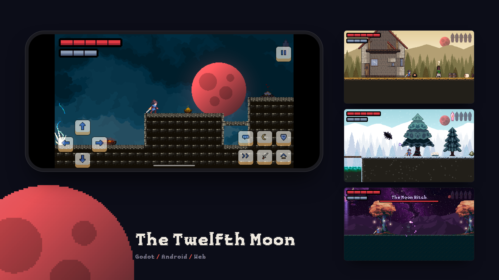

<div align="center">



# The Twelfth Moon

A 2D pixel-art action platformer with a story, made in Godot as a birthday gift.

[](https://thetwelfthmoon.vercel.app)


</div>

## About

A swordswoman crosses five chapters under a red moon to face Kael, the Ember Knight, and learns on the way who they both used to be.

- **Five chapters:** the village, the Lantern Forest, the Long Road, Ember Keep (and the undercroft beneath it) and the Twelfth Night on its roof
- **Story scenes** with voiced dialogue, four past-life memories, three mini-bosses, Kael's fight and the reveal
- **An ending**, rolling credits and an after-credits scene
- **Forgiving by design:** campfire checkpoints everywhere, slow and clearly warned enemy attacks, no harsh fail states
- **Plays on a phone:** on-screen buttons on touch screens, fullscreen and landscape in mobile browsers

## Controls

| Action | Keyboard / mouse |
|---|---|
| Move | A / D or arrow keys |
| Jump | Space / W / Up / Z / K (hold to jump higher) |
| Attack | J / X / left click (keep pressing for a combo; hold after a swing for a Moon Slash) |
| Block | Hold I / C / right click |
| Moon Spark | U / V |
| Interact | E / Enter |
| Pause | Esc / P |
| Mute | M |
| Fullscreen | F |

On a phone or tablet, on-screen buttons appear: a direction pad, and jump, sword, shield, moon spark, dash, talk and pause.

## Run it

Open this folder in **Godot 4.7.2** (Compatibility renderer) and press Play. The main scene is `res://ui/title_screen/title_screen.tscn`.

<details>
<summary><b>Tests</b></summary>

Headless, one at a time (run from this folder; use the `_console` build of Godot on Windows):

```
godot --headless --path . res://tools/tests/<name>.tscn
```

`flow_test`, `chapter_test`, `moves_test`, `enemies_test`, `chapter2_test`, `chapter3_test`, `chapter4_test`, `chapter5_test`, `scripts_test`, `story_flow_test`, `critter_test`, `audio_test`, `touch_test`, `music_test`, `sfx_test`, `ending_test`, `journal_test`. Each prints PASS/FAIL lines and a `RESULT` line, and exits non-zero on failure. Don't run two Godot processes on the project at once.

</details>

<details>
<summary><b>Project layout</b></summary>

| Folder | What's in it |
|---|---|
| `levels/` | ASCII-map chapters built into tile maps at runtime, backgrounds, tilesets |
| `entities/` | The player (a node state machine), enemies, bosses, NPCs, critters, effects, props |
| `story/` | Dialogue scripts (plain text), cutscenes, memory scenes, the ending and after-credits scene |
| `ui/` | HUD, dialogue box, title screen, credits (`ui/credits/credits.txt`) and end screen |
| `autoloads/` | `EventBus`, `GameManager`, `SceneManager`, `Audio`, `Music` |
| `tools/` | The importers that copy and recolour art from the asset packs (`import_*.py`, Python with Pillow), the resource builder (`build_resources.gd`) and the tests |

The importers expect the asset packs next to this folder, as in the original workspace.

</details>

## Credits

> [!IMPORTANT]
> The art, audio and fonts belong to their creators and are used under their own licences. Several packs forbid redistributing their files outside a game, so please don't reuse them from this repository; get them from their authors.

The game's own credits screen is `ui/credits/credits.txt`; this is a summary.

<details>
<summary><b>Art, sound and music</b></summary>

- Mariane: Characters Pack by Dreamir. Kael: Fire Knight (Elementals) by chierit. Monsters Creatures Fantasy by Luiz Melo (CC0).
- Magic Pack 9 by Ansimuz; Pixel Valley (Forest and Cave, Revamped) by kauzz; Crawling Depths by pingupollas; Pixel2DCastle by Szadi art; the 16x16 Fantasy Platformer Pack, the Knight, the Necromancer and the Skeleton Sprite Pack (authors to be confirmed).
- Village tiles, props and characters by GandalfHardcore. Skies and backgrounds by CraftPix.net.
- Super Pixel Effects Gigapack by Will Tice / unTied Games. Heal sparkles from Pixel art effects by Sentient Dream Studio.
- Sky art: Free DEMO Pixel Skies by Digital Moons (https://digitalmoons.itch.io/pixel-skies); Starry Night package (author to be confirmed).
- Voices: Super Dialogue Audio Pack v1 by Dillon Becker (https://dillonbecker.com), CC BY 4.0. Voice actors: Alex Brodie, Karen Cenon, Ian Lampert, Meghan Christian, Sean Lenhart. Changes made: clips trimmed, level-matched, resampled and made mono. Footsteps: FreeSteps (author and licence to be confirmed).
- Pixelmax font. Health & Stamina bar art (author to be confirmed).
- Phone buttons: Complete UI Essential Pack by Crusenho (CC BY 4.0, https://creativecommons.org/licenses/by/4.0/); buttons recomposed with drawn icons.
- Sound effects: RPG Essentials SFX by leohpaz.
- Music: seventeen tracks from OpenGameArt.org, each credited in `assets/music/CREDITS.txt` and on the credits screen.

</details>
